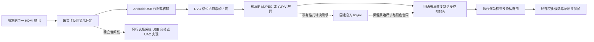

# 官方 libyuv 最小视频替代：适配性与可复现实验

**官方 libyuv 可以替代部分像素转换实现，不能解决 UVC 驱动问题，也不提供 UAC 音频。** 当前可成立的方向是保留一个另行核清的 USB/UVC 采集与解码链，只在确有输出格式需求时使用固定官方 libyuv；它不是 AndroidUSBCamera 或 UVCAndroid 的整栈替换。本轮完成静态能力核对和项目自有代码的纯合成实验，未接入任何原生运行库。

基线 `c1afb3f61fa309bde0437fa2019c352ddc1792ba`；独立分支 `codex/uvc-libyuv-feasibility`；工作区 `C:\Users\USER\Documents\Codex\2026-11-10\task-4\sidecar-uvc-feasibility`。所有变更只在 `android/uvc-sim/provenance/feasibility/`，缓存/编译出的自有 JVM 类只在被忽略的 `android/uvc-sim/build/feasibility/`。既有运行代码、公共接口、依赖声明、PRD 和历史证据均未改动。

## 能替代的层与保留的缺口

图中上游链路和音频都仍是待核验的接入设计；不是本轮已连接的设备。libyuv 的角色限于图中转换方框，不负责 USB host 权限、设备发现、接口占用、端点传输、UVC probe/commit、压缩负载重组、热插拔恢复、EDID、显示环出或 HDCP，也不负责音频源、四路接线、麦克风权限或音频健康。

| 方案 | 可移除的问题 | 仍需保留或另建的工作 | 本轮判断 |
| --- | --- | --- | --- |
| 已有 RGBX 解码出口直接形成 owned RGBA | 若仅需 RGBA，避免不必要的 RGB→YUYV/RGB565 转换和损失。 | USB/libusb/libuvc、解码、布局/alpha/stride、回调所有权、停止及显示质量全部仍需核验；要从构建输入中显式去掉不需要的转换帮助函数及引用。 | 最小数据路径候选；不能仅“不调用某回调”就声称原生依赖已移除。 |
| 保留解码链，定制 libyuv 改为完整官方源码 | 可绕开前轮 11 文件中的定制实现来源问题。保留的反向回调可用官方 API 组合替代两处定制引用。 | 所有上游采集组件仍在；像素矩阵、SIMD/尾部、内存、链接、许可材料及最终产物必须独立核对。 | 仅在所需内部输出确实需要 libyuv 时采用；不为维持旧 API 而增加有损中间格式。 |
| Camera2 外接 provider | 对已支持组合，可不在应用内打包这组 USB/UVC 转换库。 | 依赖 OEM 已有驱动/HAL/配置，真实格式与可读性另验；普通 App 不能补出缺失的系统 provider。 | 条件性平台候选，不能当通用 UVC 驱动解决方案。 |
| 只有官方 libyuv，去掉 UVC/系统采集来源 | 没有 USB 数据来源，转换函数得不到完整有效图像。 | 设备和传输层全部缺失，音频也缺失。 | **不能满足桌面采集要求。** |

## 固定来源、依赖和许可

视频研究候选继续使用 UVCAndroid `fcdae5f9a194e2111d57019176b53470a120415b`，官方 libyuv `3e38ce50589d9319badc0501f96d6c5b2b177472`（历史版本号 1840）。选择这个 libyuv 提交是为与已审定制树进行受控比较，不是对其作为最新生产版本或安全状态的推荐。官方源码与 LICENSE/PATENTS/AUTHORS 的精确身份继承前轮锁定证据；Google 专利材料及 BSD 条款不替其他组件授权。

[能力、源码及依赖报告](capabilities/REPORT.md)分别列出 Java 候选入口、native 编译输入、版本/许可和未决事项。固定 UVCAndroid 的 libusb、libuvc、libjpeg-turbo、RapidJSON、工具链及 Java/AndroidX 边界仍需保留；移除定制 libyuv 不会消除 libusb 的 LGPL 来源/修改/分发义务，也不会补足已发布 AAR 的源码到二进制映射。

若保留原 Java 模块，原构建所声明的 AndroidX 依赖仍存在。若另建最小包装，静态候选文件闭包可能更小；候选清单、POM 声明并集和最终 APK 所含依赖是三个不同结果。这里没有实际 Gradle variant 解析、编译、动态引用验证或 APK 清单。不能通过手工排除依赖就假设可运行。

AndroidUSBCamera 的旧四 ABI UAC blobs 仍不在可采用范围。libyuv 没有为它们补出源码或许可。系统 AudioRecord 与 nExtCamera/libuac 各自有独立来源、权限、路由和验证成本，详见 [音频缺口报告](audio-gap/REPORT.md)。保留 C 路远端记录不会自动获得 B 路本地发言回电脑或 D 路本地发言记录；A/B/C/D 必须分开验证。

## 现有封版要求与代码合同

| PRD 要求 | 当前最小路线的适配条件 | 已有代码的实际边界 |
| --- | --- | --- |
| 4.1/4.3：所选单一路输出、原显示体验、组合支持矩阵和细字可读性 | 不改电脑驱动/代理，不静默改变主屏时序或裁剪。设备实际颜色范围、分辨率和帧率均需可核实。 | 转换库无法证明 EDID、环出、Hub 供电或实际输入；暂无设备验证。 |
| 4.4：可观察变化暂停并人工核屏，重连不自动开始 | 明确附件代次、授权 revision、协商格式和恢复范围。视频与音频分别处理。 | 发现器仅有描述符筛选和权限快照。Frame 格式尚未分离总线格式与像素输出，也未定义 stride、颜色范围/矩阵、方向、alpha 和有效长度。 |
| 6.1：先遮盖，再作局部候选与稳定判断，保留清晰关键帧 | 最小入口宜保留 RGB 精度与完整尺寸；候选可降采样，但原关键帧不能被候选分辨率替代。 | FramePipeline 是固定 640×360、紧密 RGBA 的合成夹具，不是生产分辨率合同；不能为接入它而自动把 1080p 缩成 640×360。 |
| 6.1：微小数字/细字变化不能为减少保存量而牺牲 | 无损通道重排可作适配；先量化 RGB565 或降到 YUY2 会引入不可逆信息损失。 | 本轮数值反例确实可让不同 RGB 图样变成相同中间结果，见下节；这不代替 OCR/设备读屏验收。 |
| 隐私暂停、旧回调拒绝、停止和缓冲释放 | native 借用指针须在有效期内复制/可靠接管；原生直出 Surface 不能绕开授权和遮盖。 | onFrame 转移独占 byte[]，拒绝也清零；不能传复用数组。driver close、StopReceipt、sink cancel、worker drain 的组合语义仍需明确。 |
| 5：独立音频授权、实际来源/健康和四路闭环 | 选择并验证音频链；禁止失源后静默换手机麦克风。 | libyuv 不提供这些能力。11 个音频合成场景已定义，尚未实现/执行，不冒充音频通过。 |

本轮 PRD 依据仍是 Library 版本 `0` 的 v1.5（1021 行，Library ID `PRIVATE_ARTIFACT_REFERENCE_OMITTED`，File Service ID `PRIVATE_ARTIFACT_REFERENCE_OMITTED`）。前轮全文及关键章节读取继续有效，本轮通过 Library 补读 239–256 行的采集策略。没有重建本地无元数据 PRD 副本，没有新增功能、产品状态或 PRD 测试编号。

## 纯合成验证与成本

[Python 像素合同实验](synthetic/README.md)用项目自有标量模型验证图样、布局、alpha、量化、色度损失和缓冲预算，并绑定所引用的固定官方源码。它给出输入图样和数值结果哈希，比较错误实现的负控制。没有调用官方 C/SIMD、JPEG 解码器、JNI 或 USB。模型通过仅说明这些约定和反例可以复现，不能宣称官方实现已通过。

[JVM 桥接实验](bridge/README.md)直接调用未修改的项目合成 FramePipeline：4 个描述性场景、42 个检查通过，并有必须失败的工作线程故障负控制。已验证 padded RGBX 的受控复制、未定义 X 转为明确 opaque alpha、单像素标记保留、遮盖、旧帧拒绝、停止期间不发布及显式 drain 后清零。1080p 输入验证的是固定格式拒绝；“一帧超过 7 MiB”另是算术比较，没有声称触发实际内存预算分支。

| 理想像素面/一次操作 | 640×360 | 1920×1080 | 含义与限制 |
| --- | ---: | ---: | --- |
| 一张 RGBA，4WH 字节 | 921,600 B | 8,294,400 B | 单张 1080p 已比夹具 7 MiB 限额多 954,368 B；该限额不是手机能力结论。 |
| 源面 + 一份 owned 复制，8WH | 1,843,200 B | 16,588,800 B | 不含解码、USB、JNI、队列、遮盖/编码、Surface 或其他 App 内存。 |
| 30 fps 下每帧复制一次的理想读+写流量，8WH×30 | 55,296,000 B/s | 497,664,000 B/s | 算术估计，非吞吐、CPU、耗电或时延实测。 |
| 整帧 ABGR→ARGB→YUY2 的示例峰值 | 详见模型 | 约 12WH = 24,883,200 B | 包含源、临时、目的面及所选官方路径内部 scratch；不应只算外部临时面。按行策略可降低 scratch，但增加调用/分配成本，仍未测性能。 |

PRD 的每秒 1–5 个候选帧是实验参数，不等于 HDMI/USB 帧率。降低候选处理频率并不会自动降低 UVC 传输、完整帧组装、解码或回调成本；只有在准确理解丢帧位置、所有权和实际协商结果后才能评估成本。这里不承诺帧率、带宽、温升或节省比例。

## 后续可复现实验顺序

1. 主集成先确认生产像素合同与预算：总线格式和输出格式分开，明确矩阵/范围、方向、stride、有效长度、opaque alpha、主机接收时钟域与所有权。仍用合成 fixture 验证，不改变现有公共接口以迁就某个 SDK。
2. 决定是否确需保留 YUYV/RGB565 内部回调。如果只需 RGBA，优先避免往返及有损中间格式；从构建输入明确排除不使用的 helper/符号。若确需 libyuv，保留完整固定官方源码和适用声明，仅用项目自有适配调用官方 API，不搬入未核清定制实现。
3. 原有源码/许可准入条件满足后，才执行另一个隔离的 native 对照实验：同一图样、同一矩阵/范围、明确 stride/容量，先官方 C 路径，再目标 CPU/SIMD 路径；逐字节/有界误差对照，专门检查奇数尾、padding、alpha、无效/损坏输入与颜色采样。记录精确工具链、所有编译输入、链接和输出哈希，不沿用 Maven 产物身份。**本轮未执行此步骤。**
4. 对 future native adapter 用可控回调来源验证借用缓冲、迟到/乱序回调、取消、stop/close 阻塞或失败、所有处理排空与直接 Surface 输出隔离；官方 libyuv 的像素正确性不能替代这部分。
5. 最后仍按既有 G1/G2 门禁验证实际采集组合、原显示、清晰关键帧、四路音频、时基、功耗/温控及长时联合场景。任何一条路径不满足就保持对应能力未放行，不能静默换麦、降低显示或扩大 PRD。

当前建议：可合并研究与合成实验；原生采集与分发保持关闭。优先收敛 owned RGBA 数据合同，再决定“无需 libyuv 的直接路径”或“保留必要官方转换”的最小实现。换库本身不能关闭 UVC 驱动、其他 native 许可或设备兼容问题。

重放命令、返回码、工具版本与文件哈希见 [VALIDATION.json](VALIDATION.json)。音频场景仅做结构校验，不能把其未执行的内容计入测试通过数。
